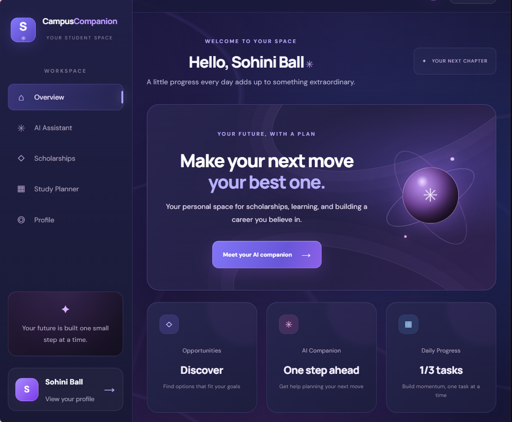
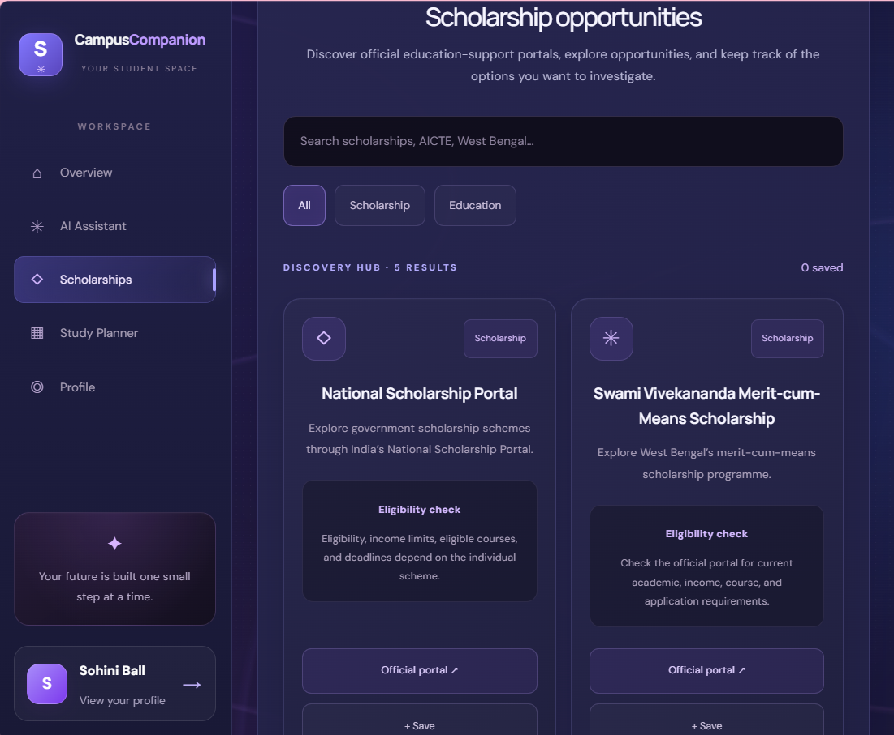
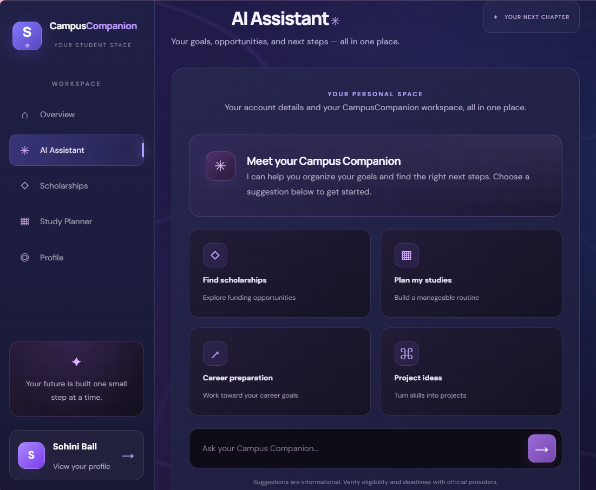
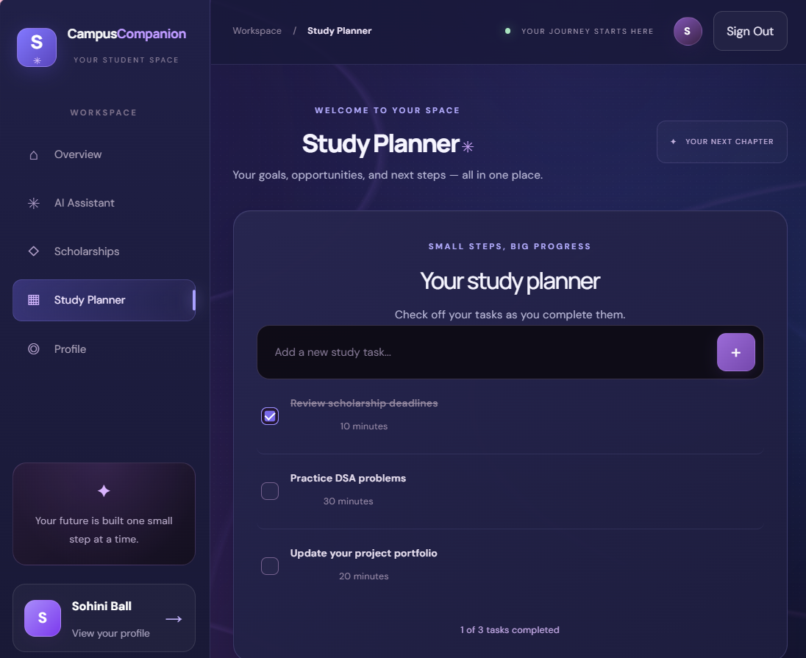
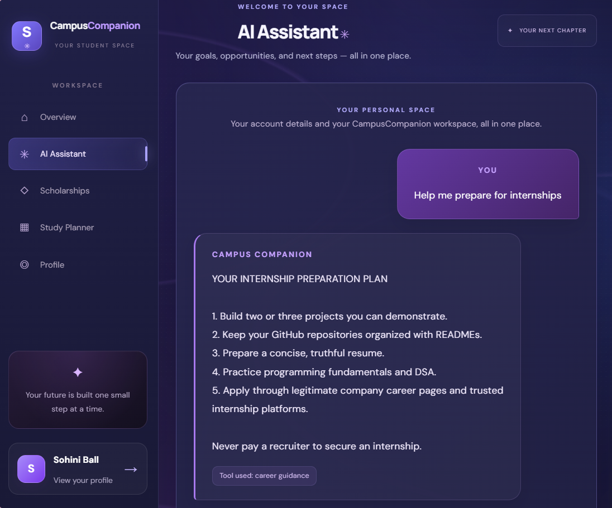

<div align="center">

# 🎓 CampusCompanion AI

### Your goals. Your opportunities. Your next step.

**One student-focused workspace to organize learning, explore educational opportunities, and prepare for your future.**

CampusCompanion AI brings study planning, scholarship discovery, career guidance, and structured student support together in one accessible dashboard.

<br/>

[🌐 Live Demo](https://campuscompanion-ai.vercel.app/) · [💻 Source Code](https://github.com/ballsohini939-alt/campuscompanion-ai) · [🐛 Report an Issue](https://github.com/ballsohini939-alt/campuscompanion-ai/issues)

<br/>


</div>

---

## 🖥️ Application Screenshots

Explore the CampusCompanion AI interface and its student-support features.

### 🏠 Main Dashboard



### 🎓 Scholarship Discovery



### 🤖 Student Guidance Assistant



### 📚 Study Planning



### 💼 Career Preparation



---

## 📌 Table of Contents

* [The Problem](#-the-problem)
* [Our Solution](#-our-solution)
* [Key Features](#-key-features)
* [What Makes It Different](#-what-makes-it-different)
* [Technology Stack](#-technology-stack)
* [Application Workflow](#-application-workflow)
* [Getting Started](#-getting-started)
* [Build for Production](#-build-for-production)
* [Project Structure](#-project-structure)
* [Privacy and Transparency](#-privacy-and-transparency)
* [Current Limitations](#-current-limitations)
* [Future Roadmap](#-future-roadmap)
* [Contributing](#-contributing)
* [License](#-license)
* [Project Vision](#-project-vision)

---

## 💡 The Problem

Student life involves more than attending classes and preparing for exams.

Students often need to navigate multiple websites and tools to:

* 🔎 Discover scholarships and education-support opportunities.
* 📚 Organize study tasks and revision schedules.
* 💼 Explore internships and career-preparation resources.
* 🧭 Decide which learning or career step to take next.
* 📌 Keep useful opportunities organized for future reference.

When these activities are scattered across different platforms, staying organized becomes another challenge.

**Students need a clearer starting point—not another complicated system.**

---

## 🚀 Our Solution

CampusCompanion AI is a student-support dashboard designed to bring these activities into one accessible workspace.

It combines scholarship discovery links, a guided student assistant, study planning, and career-oriented guidance through a unified interface.

Instead of trying to replace official education portals, CampusCompanion AI helps students discover relevant resources, organize their next steps, and know where to continue their research.

### 🎯 Built Around Three Principles

| Principle       | What It Means                                                   |
| --------------- | --------------------------------------------------------------- |
| 🔎 **Discover** | Explore scholarship portals and educational opportunities.      |
| 📅 **Organize** | Save interesting opportunities and manage study tasks.          |
| 🚀 **Prepare**  | Access structured guidance for learning, projects, and careers. |

---

## ✨ Key Features

### 🤖 1. Student Guidance Assistant

A guided assistant that provides predefined responses and structured suggestions for common student needs.

**Explore guidance for:**

* Scholarship discovery and eligibility research.
* Study planning and revision routines.
* Internship and career preparation.
* Beginner-friendly programming projects.

**How it works:** The current assistant uses predefined, rule-based responses. It does not connect to a live generative AI model.

### 🎓 2. Scholarship Discovery

Explore educational-support resources and scholarship portals from one interface.

**Features include:**

* 🔍 Search opportunity listings by keywords.
* 🗂️ Filter listings by category.
* ⭐ Save and unsave interesting opportunities.
* 💾 Retain saved opportunity IDs using browser local storage.
* 🔗 Visit linked official portals to research requirements.

**Designed for informed exploration:** Scholarship listings are discovery resources, not verified announcements that applications are currently open. Always check deadlines and eligibility on the official provider's website.

### 📚 3. Study Planning

Turn academic intentions into manageable tasks.

* Organize study activities.
* Track task completion.
* Review progress through the available interface.
* Build a more structured study routine.

Use the planner to bring your next academic tasks into focus.

### 💼 4. Career Preparation

Explore practical suggestions for developing technical skills and preparing for opportunities.

Topics include:

* Building beginner-friendly coding projects.
* Improving GitHub repositories.
* Preparing resumes.
* Strengthening programming fundamentals.
* Exploring software development and internship preparation.

### 🎨 5. Student-Focused Dashboard

A unified interface designed to make the platform easier to navigate.

* Dark, modern visual design.
* Responsive dashboard elements.
* Interactive navigation.
* Searchable opportunity listings.
* Organized student-support sections.
* Persistent saved-opportunity state in the browser.

---

## 🌟 What Makes It Different?

CampusCompanion AI focuses on the everyday tasks that connect education, planning, and career preparation.

| Challenge                                            | CampusCompanion AI Approach                           |
| ---------------------------------------------------- | ----------------------------------------------------- |
| Useful resources are scattered.                      | Bring discovery links into one interface.             |
| Interesting opportunities are easy to lose track of. | Save and revisit selected listings.                   |
| Study tasks can feel overwhelming.                   | Organize academic activities into manageable tasks.   |
| Career preparation can be difficult to navigate.     | Offer structured suggestions and starting points.     |
| Automated guidance can be misunderstood.             | Clearly distinguish rule-based guidance from live AI. |

**The goal is not to make decisions for students. It is to help them explore options and organize their own next steps.**

---

## 🛠️ Technology Stack

CampusCompanion AI is built using a modern JavaScript web-development workflow.

| Technology                | Purpose                                                |
| ------------------------- | ------------------------------------------------------ |
| **React**                 | Component-based user interface.                        |
| **Vite**                  | Development server and build tooling.                  |
| **JavaScript**            | Application logic and interactions.                    |
| **CSS**                   | Dashboard styling and responsive presentation.         |
| **Browser Local Storage** | Retaining saved opportunity IDs in the browser.        |
| **ESLint**                | Identifying common JavaScript and code-quality issues. |
| **Git & GitHub**          | Version control and source-code hosting.               |
| **Vercel**                | Hosting the deployed web application.                  |

*The table describes the documented stack and development workflow. It does not imply that every listed tool provides a runtime service to the application.*

---

## 🔄 Application Workflow

The typical student journey looks like this:

**Open the dashboard**

↓

**Choose a student-support activity**

↓

**Explore guidance, scholarship resources, or study tasks**

↓

**Save relevant opportunities and organize next steps**

↓

**Continue research through official providers and external resources**

This workflow keeps discovery and organization connected while leaving important decisions and eligibility verification with the student and the relevant provider.

---

## 🚀 Getting Started

Run CampusCompanion AI locally to explore its code and experiment with the application.

### Prerequisites

Install:

* [Node.js](https://nodejs.org/) — use a supported version compatible with the project's dependencies.
* npm — included with Node.js.

Check your installation:

```bash
node --version
npm --version
```

### 1. Clone the Repository

```bash
git clone https://github.com/ballsohini939-alt/campuscompanion-ai.git
```

### 2. Enter the Project Directory

```bash
cd campuscompanion-ai
```

### 3. Install Dependencies

```bash
npm install
```

### 4. Start the Development Server

```bash
npm run dev
```

Open the local URL displayed in your terminal, typically:

```text
http://localhost:5173/
```

If that port is already in use, Vite may select another available port.

### 5. Explore the Application

Navigate through the available dashboard sections and try the implemented interactions.

---

## 📦 Build for Production

Create an optimized production build:

```bash
npm run build
```

Preview the production build locally:

```bash
npm run preview
```

Vite will display the local preview URL in the terminal.

**Tip:** Run the production build before submitting significant changes to help catch build-time errors.

---

## 📁 Project Structure

The application is organized as a React/Vite project.

```text
campuscompanion-ai/
├── public/                 # Public static assets, if present
├── screenshots/            # Application screenshots
│   ├── dashboard.png
│   ├── scholarship-discovery.png
│   ├── student-assistant.png
│   ├── study-planning.png
│   └── career-preparation.png
├── src/
│   ├── App.jsx              # Main React application
│   └── App.css              # Application styling
├── index.html               # HTML entry point
├── package.json             # Dependencies and npm scripts
├── package-lock.json        # Locked dependency versions
├── vite.config.js           # Vite configuration, if present
└── README.md                # Project documentation
```

*This is a simplified overview. Exact files and directories may vary with the current repository version.*

---

## 🔒 Privacy and Transparency

CampusCompanion AI is a prototype. Understanding how its current features work is important.

* **Saved opportunities:** Selected opportunity IDs are retained using browser local storage.
* **Guided assistant:** Responses are predefined and rule-based, not generated by a live AI model.
* **Scholarship resources:** Links support discovery and further research; they do not guarantee that a program is open.
* **Eligibility:** The application does not guarantee eligibility or scholarship selection.
* **External websites:** Providers may have their own privacy policies and data-handling practices.
* **Sensitive information:** Avoid entering sensitive personal information into a prototype.

Always confirm application deadlines, eligibility criteria, and official requirements directly with the relevant provider.

---

## ⚠️ Current Limitations

The current version prioritizes an accessible interface and useful student workflows.

Known limitations include:

* No live generative AI integration.
* No automatic verification of scholarship availability or deadlines.
* No guarantee of scholarship eligibility or selection.
* Saved opportunity IDs are stored in the current browser rather than synchronized through a dedicated database.
* The accuracy and completeness of available resources depend on the information linked in the application.

These limitations help define the next stage of development.

---

## 🗺️ Future Roadmap

The following are planned improvements, not claims about existing functionality.

* [ ] Integrate verified scholarship data sources.
* [ ] Add deadline reminders and application-status tracking.
* [ ] Develop eligibility checks using verified provider criteria.
* [ ] Introduce database-backed storage and optional account synchronization.
* [ ] Explore a live AI service with appropriate safeguards and infrastructure.
* [ ] Improve accessibility and keyboard navigation.
* [ ] Add automated tests for important user workflows.
* [ ] Expand student resources and career-preparation guidance.

---

## 🤝 Contributing

Ideas, feedback, and improvements can help make CampusCompanion AI more useful to students.

Potential contributions include:

* Improving accessibility and responsive design.
* Fixing bugs and improving reliability.
* Expanding documentation.
* Adding automated tests.
* Suggesting useful student-support workflows.

### Suggested Contribution Workflow

1. Fork the repository.
2. Create a branch for your change.
3. Make and test your changes.
4. Commit your work with a clear message.
5. Open a pull request describing the improvement.

Please check the repository's license before reusing or redistributing its code.

---

## 📄 License

**License status: To be confirmed.**

Before presenting this project as open source, add an appropriate license file to the repository and update this section with the license name.

Without an applicable license, other people generally do not automatically receive permission to reuse, modify, or redistribute your code.

---

## 🎯 Project Vision

CampusCompanion AI began with a simple idea:

**Students should spend less time organizing scattered resources and more time taking meaningful steps toward their goals.**

By bringing opportunity discovery, study planning, and career guidance into one student-focused workspace, the project aims to make everyday academic planning clearer and more manageable.

Built as a practical web-development project, it represents an ongoing effort to create technology that supports students through their learning journey.

<div align="center">

### 🎓 Built for Students. Designed for Possibilities.

**Explore. Organize. Prepare.**

[🌐 Open the Live Demo](https://campuscompanion-ai.vercel.app/)

</div>
